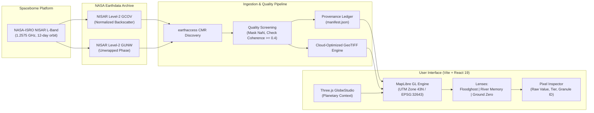

<div align="center">


<br/>

<a href="https://nasa-space-apps-earth-pulse.vercel.app/"></a>
<a href="https://www.spaceappschallenge.org/"></a>
<a href="https://www.spaceappschallenge.org/2026/challenges/dancing-with-the-sars/"></a>
<a href="#team-orions"></a>
<a href="LICENSE"></a>

<br/><br/>


<br/>

[Live Application](https://nasa-space-apps-earth-pulse.vercel.app/) • [Master PRD Specification](earth-pulse-ahmedabad%20(1).md) • [Presentation Deck](Earth%20Pulse%20-%20NASA.pptx) • [ISRO and NASA Scientific Defense](isro_judge_qa_200_questions.md)

</div>

<br/>

> **Core Research Question:**  
> *"The river changes what is wet. The city changes what is built. Sometimes, the ground beneath both changes too. Can we see the difference?"*

---

## Executive Overview

**Earth Pulse — Ahmedabad** is an open-source Synthetic Aperture Radar (SAR) evidence observatory developed for the **NASA International Space Apps Challenge 2026** under the track **Dancing with the SARs**.

During monsoon cycles across South Asia, traditional optical satellites (Landsat, Sentinel-2) are severely limited by dense, persistent cloud cover, while municipal ground gauges lack spatial density. Earth Pulse utilizes **NASA–ISRO Synthetic Aperture Radar (NISAR)** L-band microwave observations (~24 cm wavelength) to provide continuous, all-weather monitoring over the Ahmedabad–Sabarmati metropolitan region.

Rather than presenting an unverified black-box model, Earth Pulse decouples complex radar physics into **three specialized analytical lenses** underpinned by a **5-tier evidence grammar**. This framework provides auditable satellite intelligence while preventing the common pitfall of confusing spatial co-location with physical causation.

<br/>

## Technical Stack

<div align="center">


</div>

```python
system_pipeline = {
    "spaceborne_sensor": "NASA-ISRO SAR (NISAR) L-band (1.2575 GHz, lambda = 23.84 cm)",
    "level_2_products": ["NISAR_L2_GCOV (Radar Covariance / Backscatter)",
                         "NISAR_L2_GUNW (Geocoded Unwrapped Interferograms)"],
    "data_access": ["NASA Earthdata CMR API", "ASF Vertex", "earthaccess client", "NASA Harmony API"],
    "backend_compute": ["Python 3.12", "h5py", "GDAL", "Rasterio", "NumPy", "SciPy"],
    "frontend_engine": ["React 19", "Vite", "Three.js GlobeStudio", "MapLibre GL JS", "Tailwind CSS"],
    "quality_filters": ["Coherence threshold (gamma >= 0.4)", "Connected components masking", "Water decorrelation exclusion"],
}
```

<br/>

## The Three Scientific Lenses

<table>
<tr>
<td width="33%" valign="top">

### FLOODGHOST
**Hydrological Inundation**

- **Product:** Level-2 GCOV (10–20 m).
- **Physical Principle:** Calm open water acts as a specular reflector, scattering radar pulses away from the monostatic antenna (appearing dark, typically $B_{\text{dB}} < -18\text{ dB}$).
- **Double-Bounce Detection:** Water beneath vegetative canopies forms a dihedral corner reflector between the water surface and vertical trunks, yielding anomalously bright co-polarized (HH) returns.
- **Output:** Delineates candidate open water and sub-canopy inundation without confusing structural shadow for floodwaters.

</td>
<td width="33%" valign="top">

### RIVER MEMORY
**Riverfront Dynamics**

- **Product:** Multi-temporal GCOV pairs across identical orbital tracks and geometries.
- **Physical Principle:** Pixel-by-pixel radiometric cross-ratio calculation ($\Delta B_{\text{dB}} = 10 \log_{10}(p_2 / p_1)$).
- **Classification Schema:**
  - **Persistent Water:** Uniform low backscatter across both timestamps.
  - **Newly Inundated Land:** Transition from high to low backscatter.
  - **Exposed / Dried Margin:** Transition from water to dry surface.
- **Guardrail:** Integrates water management context (Vasna Barrage discharge) to avoid mistaking regulated levels for structural bank erosion.

</td>
<td width="34%" valign="top">

### GROUND ZERO
**Millimeter Geodesy**

- **Product:** Level-2 GUNW Interferograms (80 m spatial posting).
- **Physical Principle:** Repeat-pass interferometric phase differences ($\Delta\phi$) across a 12-day temporal baseline.
- **Quality Gates:**
  - Coherence thresholding: strictly $\gamma \ge 0.4$.
  - Phase unwrapping error isolation via connected components.
  - Active water masking: incoherent water bodies are explicitly removed from deformation fields.
- **Output:** Calibrated Line-of-Sight (LOS) displacement maps screening for localized ground subsidence.

</td>
</tr>
</table>

<br/>

## Multi-Layer Synthesis: CONNECTIONS

The **CONNECTIONS** module integrates all three observations over the exact same spatial bounding box in Ahmedabad. 

To maintain scientific integrity, the interface enforces a non-negotiable principle: **spatial co-incidence does not demonstrate physical causation.** An area exhibiting both river margin fluctuation and ground displacement presents distinct physical processes that require independent geotechnical verification rather than speculative attribution.

<br/>

## The Honest Evidence Grammar

To eliminate false-positive alarms and synthetic hallucinations, every visual element in Earth Pulse is bound to an auditable 5-tier classification contract:

| Evidence Tier | Operational Criteria | Interface Presentation |
| :--- | :--- | :--- |
| **OBSERVED** | Direct, calibrated radar backscatter or phase measurements from verified NASA granule IDs. | Solid layer, full spectral readout |
| **DERIVED** | Quantities computed through documented deterministic formulas with bounded error margins. | Standard classified overlay |
| **INTERPRETATION** | Physically consistent mechanisms inferred from electromagnetic scattering models. | Outlined boundary with contextual tooltip |
| **HYPOTHESIS** | Candidate physical causes requiring supplementary in-situ or hydrological validation. | Dashed boundary, competing hypothesis panel |
| **UNAVAILABLE** | Spatial zones where coherence drops below threshold, data gaps occur, or noise dominates. | Explicit transparent mask with unavailable notice |

<br/>

## Mathematical Formulations

All calculations are implemented symmetrically in both client-side JavaScript (`src/earth-pulse/math.js`) and server-side Python (`pipelines/earthpulse_math.py`), confirmed via cross-language regression tests.

### 1. Radar Backscatter Power to Decibels
Given linear terrain-corrected gamma-nought ($\gamma^0$) power $p > 0$ from the covariance matrix diagonal:
```math
B_{\text{dB}} = 10 \log_{10}(p)
```
*(A factor of 10 is used because covariance diagonal values represent intensity/power rather than amplitude).*

### 2. Multi-temporal Backscatter Ratio
Change between baseline acquisition $p_1$ and secondary acquisition $p_2$:
```math
\Delta B_{\text{dB}} = 10 \log_{10}(p_2) - 10 \log_{10}(p_1) = 10 \log_{10}\left(\frac{p_2}{p_1}\right)
```

### 3. Interferometric Phase to Line-of-Sight Displacement
Converting unwrapped interferometric phase ($\Delta\phi_{\text{unwrapped}}$ in radians) to relative Line-of-Sight displacement ($d_{\text{LOS}}$ in millimeters):
```math
d_{\text{LOS}} = -\frac{\lambda}{4\pi} \Delta\phi_{\text{unwrapped}}
```
For NISAR L-band center wavelength ($\lambda \approx 238.4\text{ mm}$):
```math
d_{\text{LOS}} \approx -18.971 \cdot \Delta\phi_{\text{unwrapped}}\text{ (mm)}
```
*(Negative values indicate displacement away from the radar antenna, characteristic of surface subsidence).*

### 4. Interferometric Coherence Estimator
Degree of statistical phase correlation across repeat acquisitions over window of size $N$:
```math
\gamma = \frac{\left|\sum_{i=1}^N s_{1,i} s_{2,i}^*\right|}{\sqrt{\sum_{i=1}^N |s_{1,i}|^2 \sum_{i=1}^N |s_{2,i}|^2}}, \quad 0 \le \gamma \le 1
```

<br/>

## System Architecture



<br/>

## Study Area Specifications

The research bounding box encompasses the Ahmedabad urban expanse, the Sabarmati River corridor, and peripheral industrial subsidence zones identified in peer-reviewed literature (*Pandit et al., 2025*):

```yaml
Location: Ahmedabad–Sabarmati Urban Corridor, Gujarat, India
Bounding Box Coordinates (W, S, E, N): 72.42, 22.88, 72.72, 23.19
Centroid: 72.57°E, 23.035°N
Geographic Reference: EPSG:4326 (WGS84)
Projected Analysis Reference: EPSG:32643 (UTM Zone 43N)
Key Target Zones:
  - Sabarmati Central Riverfront and Engineered Embankments
  - Vasna Barrage Hydraulic Regulation Point
  - Southwest and Southeast Peri-Urban Industrial Belts
```

<br/>

## Quickstart & Installation

### Prerequisites
- Node.js v18.0.0 or higher (v20+ recommended)
- Python 3.10+ (for backend processing scripts)
- Git

### 1. Web Application

```bash
# Clone the repository
git clone https://github.com/memehdi14/NasaSpaceApps.git
cd NasaSpaceApps

# Install dependencies
npm install

# Run the local development server
npm run dev

# Open local environment: http://127.0.0.1:5173
```

To build for production deployment:
```bash
npm run build
npm run preview
```

### 2. Python Pipeline & NASA CMR Search

```bash
# Set up Python virtual environment
python -m venv venv
source venv/bin/activate  # On Windows: venv\Scripts\activate

# Install pipeline requirements
pip install -r pipelines/requirements.txt

# Perform dry-run CMR search for Ahmedabad NISAR granules
python pipelines/inventory_ahmedabad.py --dry-run
```

### 3. Automated Test Verification

#### Frontend and Mathematical Integrity (Vitest):
```bash
npm test
```

#### Backend Radar Geodesy Verification (Pytest):
```bash
pytest tests/python
```

<br/>

## NASA & Space Agency Data Resources

| Resource | Origin | Identifier / Access Point | Function in Project |
| :--- | :--- | :--- | :--- |
| **NISAR L2 GCOV** | NASA / ASF DAAC | `NISAR_L2_GCOV_PROVISIONAL_V1` / `V1` | Calibrated radar backscatter for hydrological mapping |
| **NISAR L2 GUNW** | NASA / ASF DAAC | `NISAR_L2_GUNW_PROVISIONAL_V1` / `V1` | Unwrapped phase and coherence for deformation screening |
| **NASA Harmony API** | NASA Earthdata | [harmony.earthdata.nasa.gov](https://harmony.earthdata.nasa.gov/) | Cloud spatial subsetting and GeoTIFF translation |
| **ASF Vertex Portal** | Alaska Satellite Facility | [search.asf.alaska.edu](https://search.asf.alaska.edu/) | Geographic SAR discovery catalog |
| **ISRO SAC Mission** | ISRO Space Applications Centre | [isro.gov.in/NISAR.html](https://www.isro.gov.in/NISAR.html) | Mission payload parameters and orbital mechanics |
| **Sentinel-1 Study** | ISPRS Annals (2025) | [doi:10.5194/isprs-annals-X-G-2025-613-2025](https://doi.org/10.5194/isprs-annals-X-G-2025-613-2025) | Historical reference dataset for Ahmedabad subsidence |

<br/>

## Team Orions

Developed for the **NASA International Space Apps Challenge 2026** (Nirma University Local Event):

<table>
<tr>
<td align="center" width="16.66%">
<b>Mohammad Mehdi Namdar</b><br/>
<sub>Team Lead / Architecture</sub>
</td>
<td align="center" width="16.66%">
<b>Dev Chauhan</b><br/>
<sub>Geospatial / Pipeline</sub>
</td>
<td align="center" width="16.66%">
<b>Jay Pujara</b><br/>
<sub>Frontend Engineering</sub>
</td>
<td align="center" width="16.66%">
<b>Numa Meman</b><br/>
<sub>SAR Research / Analysis</sub>
</td>
<td align="center" width="16.66%">
<b>Jiya Patel</b><br/>
<sub>UI/UX & Documentation</sub>
</td>
<td align="center" width="16.66%">
<b>Lakshya Jain</b><br/>
<sub>Data Verification / Testing</sub>
</td>
</tr>
</table>

<br/>

<div align="center">

<a href="https://nasa-space-apps-earth-pulse.vercel.app/"></a>

<br/><br/>


<br/>


</div>
