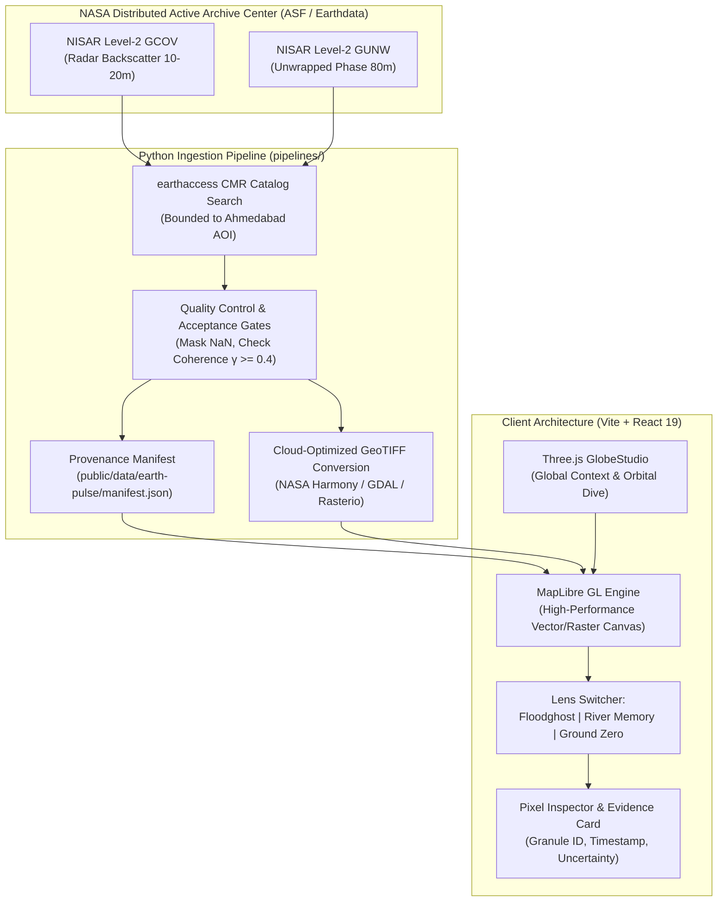

<div align="center">

# 🛰️ EARTH PULSE — AHMEDABAD
### One familiar city. Three forms of surface change. One NISAR radar evidence explorer.

[](https://www.spaceappschallenge.org/)
[](https://www.spaceappschallenge.org/2026/challenges/dancing-with-the-sars/)
[](#-team-orions)
[](#-study-area)
[](LICENSE)

[](https://react.dev/)
[](https://vitejs.dev/)
[](https://threejs.org/)
[](https://maplibre.org/)
[](https://www.python.org/)
[](https://github.com/nsidc/earthaccess)
[](https://vitest.dev/)

**[🚀 Live Demo](https://github.com/memehdi14/NasaSpaceApps)** • **[📑 Master PRD & Science Spec](earth-pulse-ahmedabad%20(1).md)** • **[📊 Slide Deck (7 Slides)](Earth%20Pulse%20-%20NASA.pptx)** • **[❓ ISRO/NASA Q&A Compendium](isro_judge_qa_200_questions.md)**

</div>

---

> **Judge Hook:**  
> *"The river changes what is wet. The city changes what is built. Sometimes, the ground beneath both changes too. Can we see the difference?"*

---

## 📖 Table of Contents
- [Executive Overview](#-executive-overview)
- [Why Ahmedabad & Why NISAR L-Band?](#-why-ahmedabad--why-nisar-l-band)
- [The Three Scientific Lenses](#-the-three-scientific-lenses)
  - [1. FLOODGHOST — Hydrological Dynamics](#1-floodghost--hydrological-dynamics)
  - [2. RIVER MEMORY — Sabarmati Riverfront Transitions](#2-river-memory--sabarmati-riverfront-transitions)
  - [3. GROUND ZERO — Millimeter Land Subsidence](#3-ground-zero--millimeter-land-subsidence)
- [Scientific Rigor: The Honest Evidence Grammar](#-scientific-rigor-the-honest-evidence-grammar)
- [Mathematical Framework](#-mathematical-framework)
- [System Architecture & Data Pipeline](#-system-architecture--data-pipeline)
- [Study Area (AOI Specifications)](#-study-area-aoi-specifications)
- [Quickstart & Local Installation](#-quickstart--local-installation)
  - [Web Application (Vite + React)](#1-web-application-vite--react)
  - [Python Data Pipeline (earthaccess + NASA CMR)](#2-python-data-pipeline-earthaccess--nasa-cmr)
  - [Running the Test Suites](#3-running-the-test-suites)
- [NASA & Partner Data Resources](#-nasa--partner-data-resources)
- [Team Orions](#-team-orions)
- [License & Open Access](#-license--open-access)

---

## 🌍 Executive Overview

**Earth Pulse — Ahmedabad** is an open-source Synthetic Aperture Radar (SAR) evidence explorer built for the **NASA International Space Apps Challenge 2026** under the *"Dancing with the SARs"* track.

Optical satellites (such as Landsat and Sentinel-2) are fundamentally limited by persistent cloud cover during critical South Asian monsoon events, and ground inspection gauges are geographically sparse. **Earth Pulse** leverages **NASA–ISRO Synthetic Aperture Radar (NISAR)** L-band data (~24 cm wavelength) to provide continuous, day-and-night, all-weather observations over the Ahmedabad metropolitan area.

Rather than delivering a speculative black-box machine-learning dashboard, Earth Pulse combines active microwave backscatter ($B_{\text{dB}}$) and interferometric phase ($\Delta\phi_{\text{InSAR}}$) into **three distinct physical lenses**, backed by an unyielding **evidence grammar** that transparently demarcates direct observations from inferences and flags data uncertainties.

---

## ⚡ Why Ahmedabad & Why NISAR L-Band?

1. **All-Weather Cloud Penetration:** Microwave radar at L-band (1.2575 GHz, $\lambda \approx 23.84\text{ cm}$) pierces thick monsoon clouds, rain, and vegetative canopies without atmospheric attenuation.
2. **Double-Bounce Canopy Sensitivity:** Unlike shorter C-band (~5.6 cm) radar which reflects off upper leaf layers, L-band pulses penetrate down to tree trunks and soil, allowing the detection of sub-canopy inundation through dihedral double-bounce scattering.
3. **Millimeter Geodesy:** Repeat-pass interferometry (12-day temporal baseline) tracks subtle ground settlement and tectonic or hydrogeological deformation across Ahmedabad's rapidly expanding municipal perimeter.
4. **Local Relevance & Grounded Science:** Grounded in peer-reviewed subsidence literature (e.g., *Pandit et al., 2025*), addressing real-world concerns of the Ahmedabad Municipal Corporation (AMC) and Gujarat water authorities.

---

## 🔬 The Three Scientific Lenses

```
                       ┌─────────────────────────────────────────────────────────┐
                       │                NASA–ISRO NISAR L-BAND                   │
                       │           (Ahmedabad–Sabarmati Urban AOI)               │
                       └────────────────────────────┬────────────────────────────┘
                                                    │
                   ┌────────────────────────────────┴───────────────────────────────┐
                   ▼                                                                ▼
   ┌───────────────────────────────┐                                ┌───────────────────────────────┐
   │     GCOV: RADAR BACKSCATTER   │                                │   GUNW: INTERFEROMETRIC PHASE │
   │ (Calibrated Gamma-0 Power, dB)│                                │    (80m Unwrapped Phase / γ)  │
   └───────────────┬───────────────┘                                └───────────────┬───────────────┘
                   │                                                                │
         ┌─────────┴─────────┐                                                      │
         ▼                   ▼                                                      ▼
  ┌─────────────┐     ┌─────────────┐                                        ┌─────────────┐
  │ FLOODGHOST  │     │RIVER MEMORY │                                        │ GROUND ZERO │
  │ Open Water  │     │ Multi-date  │                                        │  LOS Ground │
  │ & Inundated │     │ Riverfront  │                                        │Displacement │
  │ Vegetation  │     │ Transitions │                                        │ (mm-scale)  │
  └─────────────┘     └─────────────┘                                        └─────────────┘
         │                   │                                                      │
         └───────────────────┴──────────────────────┬───────────────────────────────┘
                                                    ▼
                                    ┌───────────────────────────────┐
                                    │          CONNECTIONS          │
                                    │ Unified AOI Multi-Layer View  │
                                    │ (Co-location ≠ Causation)     │
                                    └───────────────────────────────┘
```

### 1. FLOODGHOST — Hydrological Dynamics
- **Sensor Input:** NISAR Level-2 GCOV (Geocoded Covariance, 10–20 m).
- **Core Mechanism:** Smooth water surfaces act as specular mirrors at oblique radar incidence angles, bouncing energy away from the sensor (appearing dark, typically $B_{\text{dB}} < -18\text{ dB}$).
- **Vegetation Double-Bounce:** Standing water beneath tree canopies creates a right-angle reflector (water surface $\rightarrow$ tree trunk $\rightarrow$ sensor), dramatically increasing co-polarized (HH) backscatter.
- **Physical Deliverable:** Delineation of open water candidates and candidate flooded vegetation zones without confusing urban radar shadow for water.

### 2. RIVER MEMORY — Sabarmati Riverfront Transitions
- **Sensor Input:** Multi-temporal NISAR GCOV acquisitions across identical orbital tracks and geometries.
- **Core Mechanism:** Pixel-by-pixel radiometric change detection ($\Delta B_{\text{dB}} = 10 \log_{10}(p_2 / p_1)$).
- **Classification Categories:**
  - 🔵 **Persistent Water:** Retained water signature across both observation passes.
  - 🟢 **Newly Wet Margins:** Previously dry surface transitioned to low backscatter.
  - 🟠 **Receded / Dried Land:** Previously inundated area reverted to exposed ground or bank.
- **Scientific Guardrail:** Accounts for engineered dam/barrage releases along the Sabarmati Riverfront Project to avoid falsely misclassifying normal stage variations as riverbank erosion.

### 3. GROUND ZERO — Millimeter Land Subsidence
- **Sensor Input:** NISAR Level-2 GUNW (Geocoded Unwrapped Interferogram, 80 m).
- **Core Mechanism:** Measures the phase difference ($\Delta\phi$) between two satellite passes separated by a 12-day temporal baseline.
- **Quality Gates:** 
  - Coherence gating: Only pixels with $\gamma \ge 0.4$ are processed.
  - Connected component masking: Discards decorrelated and phase-jump pixels.
  - Moving water exclusion: Sabarmati river water is automatically masked out of deformation maps due to zero phase coherence.
- **Physical Deliverable:** Relative Line-of-Sight (LOS) displacement maps ($d_{\text{LOS}}$ in mm) to screen for localized groundwater withdrawal compaction or structural settling.

---

## 🛡️ Scientific Rigor: The Honest Evidence Grammar

Earth Pulse rejects the trend of generating misleading "AI-hallucinated" satellite heatmaps. Every single visual element and inspector readout in the application is governed by a **strict 5-tier classification contract**:

| Evidence Tier | Definition | UI Treatment |
| :--- | :--- | :--- |
| `OBSERVED` | Calibrated, direct NASA instrument measurements with verified granule IDs. | Solid highlight, full spectral readout |
| `DERIVED` | Mathematically transformed products with documented uncertainty and error margins. | Standard classified display |
| `INTERPRETATION` | Physically plausible mechanisms inferred from radar principles (e.g. double bounce). | Outlined layer with explanatory tooltip |
| `HYPOTHESIS` | Plausible conditions requiring external ground-truth validation. | Dashed boundary, competing cause list |
| `UNAVAILABLE` | Regions where coherence is lost, data gaps exist, or pixels fail quality checks. | Transparent mask with explicit disclaimer |

> ⚠️ **The Golden Rule:** Earth Pulse's **CONNECTIONS** mode allows overlaying hydrologic and ground motion layers on the exact same city map, but enforces a prominent warning: **Spatial co-location does not demonstrate physical causation.**

---

## 📐 Mathematical Framework

All mathematical derivations are implemented identically in both the frontend (`src/earth-pulse/math.js`) and the Python scientific backend (`pipelines/earthpulse_math.py`), verified by automated unit tests.

### 1. Radar Decibel Conversion
Linear gamma-nought ($\gamma^0$) power from the GCOV covariance matrix diagonal is converted to decibels:
$$B_{\text{dB}} = 10 \log_{10}(p)$$

*Note:* A multiplier of 10 is used (rather than 20) because the diagonal covariance elements represent power quantities (intensity), not voltage amplitudes.

### 2. Multi-temporal Backscatter Ratio
Radiometric change between baseline ($p_1$) and repeat ($p_2$) acquisitions:
$$\Delta B_{\text{dB}} = 10 \log_{10}(p_2) - 10 \log_{10}(p_1) = 10 \log_{10}\left(\frac{p_2}{p_1}\right)$$

### 3. Interferometric Phase to Displacement
Converting unwrapped interferometric phase ($\Delta\phi_{\text{unwrapped}}$ in radians) to relative Line-of-Sight displacement ($d_{\text{LOS}}$ in millimeters):
$$d_{\text{LOS}} = -\frac{\lambda}{4\pi} \Delta\phi_{\text{unwrapped}}$$
For NISAR L-band ($\lambda = 238.4\text{ mm}$):
$$d_{\text{LOS}} \approx -18.971 \cdot \Delta\phi_{\text{unwrapped}}\text{ (mm)}$$
*(Negative value indicates movement away from the satellite, e.g., subsidence).*

### 4. Interferometric Coherence Estimator
Complex correlation coefficient evaluating radar phase stability:
$$\gamma = \frac{\left|\sum_{i=1}^N s_{1,i} s_{2,i}^*\right|}{\sqrt{\sum_{i=1}^N |s_{1,i}|^2 \sum_{i=1}^N |s_{2,i}|^2}}, \quad 0 \le \gamma \le 1$$

---

## 🏗️ System Architecture & Data Pipeline



---

## 📍 Study Area (AOI Specifications)

The project locks down a single, scientifically justified bounding box encompassing the urban core, industrial periphery, and the Sabarmati river corridor:

```yaml
Site Name: Ahmedabad–Sabarmati Urban Corridor, Gujarat, India
Bounding Box (W, S, E, N): 72.42°E, 22.88°N, 72.72°E, 23.19°N
Geographic Center: 72.57°E, 23.035°N
Base Reference CRS: EPSG:4326 (WGS84 Geographic Lat/Lon)
Projected Analysis CRS: EPSG:32643 (UTM Zone 43N)
Key Geographic Features:
  - Sabarmati River & Sabarmati Riverfront Development
  - Vasna Barrage & Southern Floodplain
  - Dense Urban Core (East & West Banks)
  - Southwest & Southeast Industrial Subsidence Corridors
```

---

## 💻 Quickstart & Local Installation

### Prerequisites
- **Node.js**: v18.0.0 or later (v20+ recommended)
- **Python**: v3.10+ (for backend pipeline and test suite)
- **NASA Earthdata Account**: (Free) Required to run live satellite catalog queries.

### 1. Web Application (Vite + React)
```bash
# Clone the repository
git clone https://github.com/memehdi14/NasaSpaceApps.git
cd NasaSpaceApps

# Install Node dependencies
npm install

# Start the local development server (with 3D globe and interactive map)
npm run dev

# Open in browser: http://127.0.0.1:5173
```

To create an optimized production build:
```bash
npm run build
npm run preview
```

### 2. Python Data Pipeline (earthaccess + NASA CMR)
```bash
# Set up a virtual environment
python -m venv venv
source venv/bin/activate  # On Windows: venv\Scripts\activate

# Install pipeline dependencies
pip install -r pipelines/requirements.txt

# Run a dry-run search for Ahmedabad NISAR granules in NASA CMR
python pipelines/inventory_ahmedabad.py --dry-run
```

### 3. Running the Test Suites

#### Frontend Mathematical & Structural Tests:
```bash
npm test
```
*Executes Vitest covering decibel conversions, phase unwrapping formulas, and manifest structure verification.*

#### Python Scientific Pipeline Tests:
```bash
pytest tests/python
```
*Validates that Python and JavaScript mathematical models produce bit-identical results across all decimal precisions.*

---

## 📡 NASA & Partner Data Resources

| Resource | Source Portal | Collection / Identifier | Usage in Earth Pulse |
| :--- | :--- | :--- | :--- |
| **NISAR L2 GCOV** | [ASF Vertex](https://search.asf.alaska.edu/) | `NISAR_L2_GCOV_PROVISIONAL_V1` / `V1` | Calibrated radar backscatter for water & flood detection |
| **NISAR L2 GUNW** | [NASA Earthdata](https://search.earthdata.nasa.gov/) | `NISAR_L2_GUNW_PROVISIONAL_V1` / `V1` | Unwrapped phase & coherence for millimeter ground motion |
| **NASA Harmony API** | [NASA Earthdata](https://harmony.earthdata.nasa.gov/) | Cloud Subsetting & COG API | Spatial clipping to Ahmedabad AOI |
| **ISRO NISAR Mission** | [ISRO SAC](https://www.isro.gov.in/NISAR.html) | Space Applications Centre, Ahmedabad | Sensor specifications & mission parameters |
| **Sentinel-1 InSAR Study** | [ISPRS Annals](https://doi.org/10.5194/isprs-annals-X-G-2025-613-2025) | *Pandit et al. (2025)* | Historical baseline reference for Ahmedabad land subsidence |

---

## 👥 Team Orions

Developed with dedication for the **NASA International Space Apps Challenge 2026** (Nirma University Local Event):

- 👨‍💻 **Mehdi Namdar**
- 👨‍💻 **Dev Chauhan**
- 👨‍💻 **Jay Pujara**
- 👩‍💻 **Numa Meman**
- 👩‍💻 **Jiya Patel**
- 👨‍💻 **Lakshya Jain**

---

## 📄 License & Open Access

This project is licensed under the **MIT License** — see the [LICENSE](LICENSE) file for details.  
All satellite data specifications follow the open-access policies of NASA and ISRO.

<div align="center">
  <sub>Built for NASA Space Apps Challenge 2026 • Dancing with the SARs</sub>
</div>
